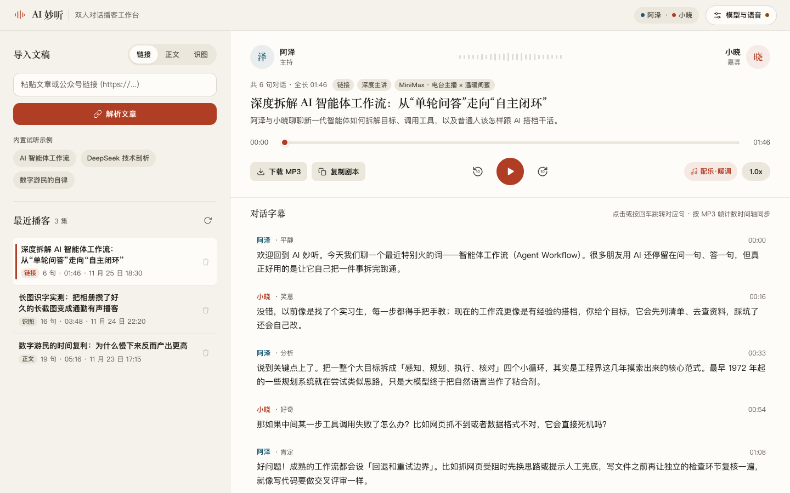
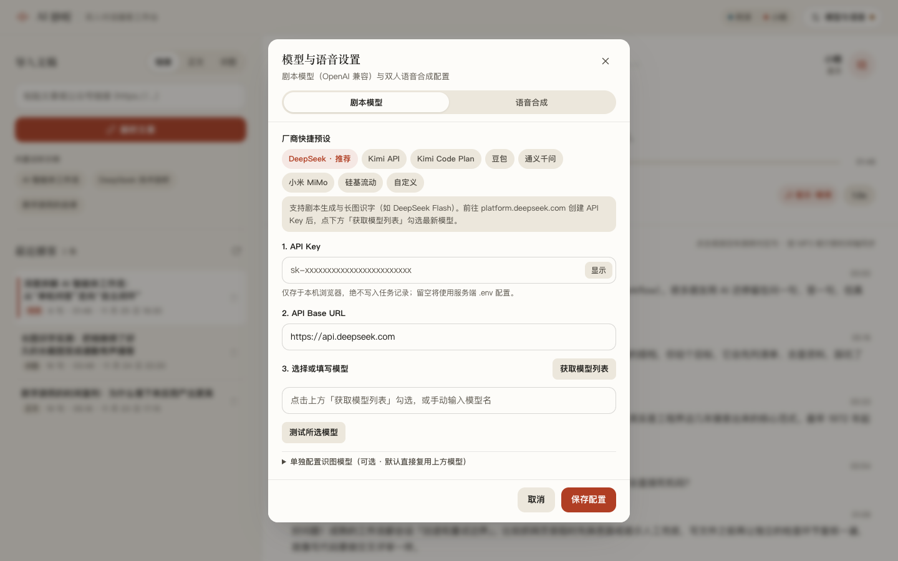
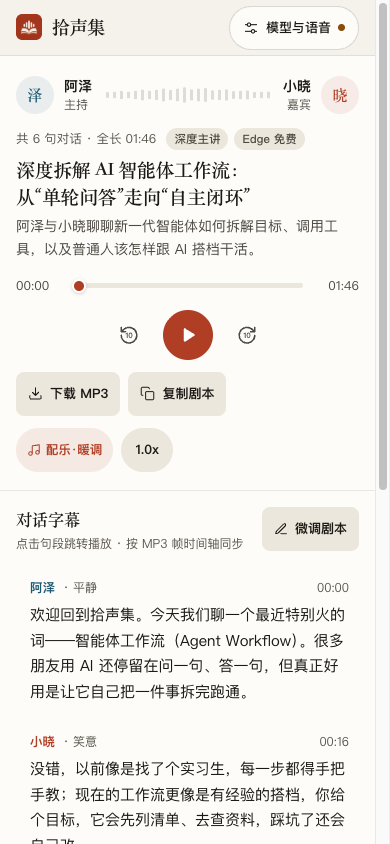

# AI 妙听 · 双人对话播客生成器

把网页长文、微信公众号文章，或者手机里截下的长图笔记，一键变成**主持人阿泽 × 嘉宾小晓**像朋友聊天一样的双人对话播客——带完整纯人声 MP3、同步高亮字幕，还有温暖克制的播音质感。

不需要安装数据库、Redis 或 `ffmpeg`，也不强制绑定任何一家服务商：你的所有密钥只留在本地浏览器，音频和文稿也只存在自己的电脑里。



---

## 为什么好用？

- **三种方式轻松导入**：贴入网页 / 公众号文章链接、直接粘贴文字，或上传多张长截图自动识字；生成前支持预览文稿和 **「AI 纠错润色」**（分段并发提速，自动剔除首尾作者编辑与底部版权/关注杂讯并整理错别字）。
- **AI 智能推荐风格，两种节目节奏听着不吵不尬**：
  - 解析或预览文稿后，后台静默结合文章内容自动推荐更匹配的节目风格与理由（仍可手动自由切换）；
  - **深度主讲（7:3，默认）**：小晓深度拆解干货，阿泽自然插话追问与总结；
  - **轻松对谈（5:5）**：两人你一言我一语轻快聊完，适合随笔与观点随聊；
  - 语音合成前会自动把 `1972 年`、`80 年代` 与 `1080P` 等规格数字转成顺口读法（字幕保留原文），并为 MiniMax 内置常见多音字词典纠偏。
- **模型和音色随你挑，自带原生从容语速**：右上角点开 **「模型与语音」**，即可接入 DeepSeek、Kimi、豆包、通义千问、小米 MiMo、硅基流动等大模型；配音支持 **MiniMax Speech**、**火山引擎豆包语音 V3** 与免费的 **Microsoft Edge**，提供 **「从容聊天（推荐）/ 标准明快」** 两档合成原生控速，保持原声音质不失真。
- **断点可续、手机也能同 Wi-Fi 听**：中途断网或换了新音色都能从断点继续生成，不白烧前面几句的额度；同一 Wi-Fi 下手机浏览器直接就能听节目，还带暖调微醺背景音乐与 `0.8x ~ 2.0x` 倍速播放。

<details>
<summary>点击展开更多界面预览：模型配置弹窗 & 手机随身听视图</summary>

<table>
  <tr>
    <td width="64%">
      
      <p align="center"><sub>「模型与语音」快捷预设（密钥仅存在本地浏览器）</sub></p>
    </td>
    <td width="36%">
      
      <p align="center"><sub>手机窄屏自动切换为单栏触控放音台</sub></p>
    </td>
  </tr>
</table>

</details>

---

## 给下载试用朋友的快速上手指南

> 只要电脑上提前装过一次 **[Node.js 22 或更新版本](https://nodejs.org/)**（官网下载安装包一路点「下一步」即可），**不用敲一行命令行** 就能直接双击使用。GitHub **Releases** 里的便携压缩包已内置全部运行依赖，解压即用。

### 1. 下载与启动（Windows / Mac 区别一览）

| 系统 | 下载解压后做什么？ | 用完怎么安全关闭？ | 第一次遇到系统弹窗怎么办？ |
|---|---|---|---|
| **Windows** | 直接双击根目录 **`AI 妙听.bat`** | 再次双击 **`AI 妙听.bat`**，按提示选择「停止服务」（也可重开网页或重启） | 若出现「Windows 已保护你的电脑」，点 **更多信息 → 仍要运行**（仅第一次需要） |
| **macOS** | 直接双击根目录 **`AI 妙听.command`** | 再次双击 **`AI 妙听.command`**，在弹窗选择「停止服务」（也可直接打开网页或重启） | 若提示“来自身份不明开发者”，**右键点击文件 → 打开**（或去「系统设置 → 隐私与安全性」点「仍要打开」一次即可——启停已合二为一，全流程仅需授权一次） |

- 启动后服务会在后台运行（默认 `3000` 端口若被占会自动顺延寻找空闲端口），并自动帮你弹出浏览器页面。
- **Mac 桌面党小技巧**：打开仓库目录下的终端运行一行 `bash scripts/build-mac-launcher.sh`，就会生成专属图标的 **`AI 妙听.app`**（可拖进程序坞）：未运行时双击弹窗点 **「启动服务」**，运行中双击弹窗直接选 **「打开网页 / 重启服务 / 停止服务」**（如用 `--portable` 参数编译分发版 `.app`，需放在便携包根目录使用；重新编译会自动清理同级旧版 `启动 AI 妙听.app`）。

### 2. 三步生成你的第一期播客

1. 点击页面右上角 **「模型与语音」**，选一家顺手的大模型厂商（例如 **DeepSeek**），填入你的 **API Key**，点 **「获取模型列表」** 勾选模型并顺手点一下 **「测试所选模型」**；
2. 切到 **「语音合成」** 标签页（可直接用免费的 Edge 快速试听，想体验真人大白话聊天感建议选 **MiniMax** 或 **火山引擎豆包语音** 并挑一对音色）；
3. 回到主页选 **「链接 / 正文 / 识图」**（或者直接点下方内置示例体验），点 **「开始生成双人播客」**，几十秒到两分钟后就能一边看字幕一边听了。

### 3. 手机在同一 Wi-Fi 下一起听

桌面和手机连着同一个路由器时，用下面任意一条命令启动，手机浏览器打开终端里打印出的局域网地址（`http://192.168.x.x:...`）即可收听：

```bash
# 方式一：通过便携启动器开启局域网访问
node scripts/start-portable.js --lan --open

# 方式二：直接用环境变量启动
HOST=0.0.0.0 npm start
```

> 为防止手机端误删电脑里攒好的播客，局域网设备默认**禁止删除本地历史**（删除请求会返回 `403`，浏览、播放和新建生成不受影响）。确实需要从手机端删节目时，可在服务端配置环境变量 `ADMIN_TOKEN`。

---

## 技术选型与开发者文档

项目刻意保持极简可审计：**Node.js 22+ · Express 5 · 原生 HTML/CSS/JS**，零第三方数据库/Redis，零外部 `ffmpeg` 二进制依赖（基于纯 JS 帧头解析计算精准时间轴并按帧量化拼接 `0.36s` 句间静音，支持单句音频缓存与 4 阶段断点续跑）。

### 常用开发与构建命令

```bash
# 源码运行
npm install
npm start                 # 后台直接运行（http://127.0.0.1:3000）
npm run dev               # 开发热重载（监听 server.js）

# 便携启动控制
npm run launcher          # 启动并自动打开浏览器（支持端口顺延）
npm run launcher:stop     # 校验进程归属后安全停止

# 质量门禁与打包
npm test                  # 运行全量 288 项离线单元测试（不联网、不耗 API 额度）
npm run release:build -- --with-deps --format both
                          # 生成跨平台 UTF-8 .zip / .tar.gz 与 SHA256SUMS.txt，
                          # 并自动运行隐私与凭据安全门禁检查
```

<details>
<summary>完整环境变量参考（均可选）与安全/架构细节</summary>

#### 1. 环境变量参考（可复制 `.env.example` 为 `.env` 使用）

| 变量名 | 默认值 | 说明 |
|---|---|---|
| `PORT` | `3000`（留空） | 服务端口；未显式指定且 `3000` 被占时便携启动器自动顺延，`0` 表示系统随机空闲端口 |
| `HOST` | `127.0.0.1` | 绑定地址；局域网手机收听请设 `0.0.0.0` |
| `ADMIN_TOKEN` | 空 | 局域网删除令牌；未设置时仅本机（loopback）可删播客，设置后非本机删播客须带 `Authorization: Bearer <token>` 或 `X-Admin-Token` |
| `DATA_DIR` | `./data` | 任务状态（`tasks/*.json`）与单句缓存（`tts-cache/*.mp3`）目录 |
| `PODCASTS_DIR` | `./public/podcasts` | 生成的成品音频与字幕元数据存放目录 |
| `DEEPSEEK_API_KEY` | 空 | 服务端默认兜底大模型 Key（仅当浏览器设置留空且未改地址时生效） |
| `LLM_BASE_URL` | `https://api.deepseek.com` | 剧本模型 OpenAI 兼容接口地址 |
| `LLM_MODEL` | `deepseek-flash` | 默认剧本生成模型名 |
| `VISION_API_KEY` / `VISION_BASE_URL` / `VISION_MODEL` | 空 | 长图识字独立视觉模型服务端兜底配置 |
| `TTS_PROVIDER` | `edge` | 默认语音合成服务商：`edge` / `minimax` / `volcengine` |
| `MINIMAX_API_KEY` / `MINIMAX_TTS_MODEL` / `MINIMAX_TTS_ENDPOINT` | 模型 `speech-02-hd` | MiniMax Speech 服务端默认配置 |
| `VOLCENGINE_TTS_API_KEY` / `VOLCENGINE_TTS_APP_ID` / `VOLCENGINE_TTS_ACCESS_KEY` / `VOLCENGINE_TTS_RESOURCE_ID` / `VOLCENGINE_TTS_ENDPOINT` | 资源 `seed-tts-2.0` | 火山引擎豆包语音 V3 服务端默认配置 |
| `ALLOW_PRIVATE_TTS_ENDPOINT` / `ALLOW_PRIVATE_FETCH` | 未开启 | 默认开启 DNS 解析后私网拦截与重定向防穿越；设为 `1` 仅作局域网自建调试 |
| `ALLOW_INSECURE_TLS` / `NODE_EXTRA_CA_CERTS` | 未开启 | 代理调试或自定义根证书选项；默认已启用 `--use-bundled-ca` 兼容主流环境 |
| `CORS_ORIGIN` | 未开启 | 默认仅同源；按需填逗号分隔白名单 |

#### 2. 已知边界与安全基线

1. **凭据零落盘**：前端填写的 API Key、AppID、Access Key 及自定义端点**绝不写入**任务 JSON、成品 `meta.json` 或接口返回值，报错消息经过统一脱敏且剥离本机路径。
2. **网络安全基线**：网页抓取器和 TTS 连接探测均执行 DNS 解析 IP 校验及跳转拦截，默认阻断回环与内网地址。
3. **正文上限与反爬回退**：单次文章上限 `12,000` 字（确定性前段截取），标题上限 `200` 字；若公众号反爬提示「环境异常」，可直接点击一键切到正文粘贴继续。
4. **打包发布红线**：`npm run release:build` 与 GitHub Actions（[.github/workflows/release.yml](.github/workflows/release.yml)）在压缩前强制拦截 `.env`、`data/`、`public/podcasts/*`、`.app`、内部规划文档、私有路径与密钥痕迹，仅打包纯净程序文件，随带 `SHA256SUMS.txt` 校验。

</details>

---

基于 [MIT License](LICENSE) 开源。如果这期「阿泽 × 小晓」帮到了你，欢迎点个 Star，或者在 Issues 里聊聊你最想读/听什么文章类型。
